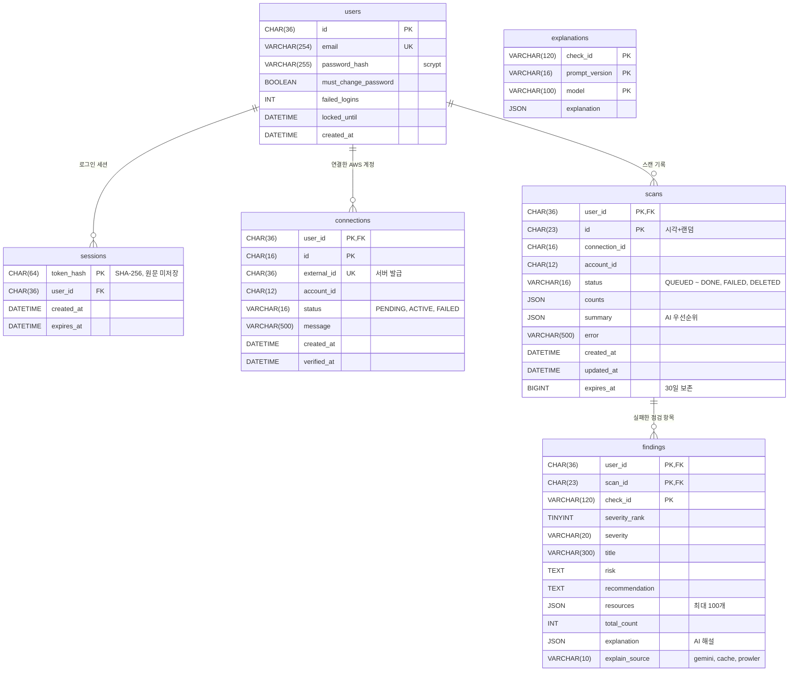

# ERD (MySQL 8.4)

스키마 원본은 `db/init/01-schema.sql`. GitHub에서 이 파일을 열면 그림으로 보인다.

## 설계 포인트 (발표용)

- **사용자 격리**: 사용자 데이터 테이블(`connections`, `scans`, `findings`)은 기본 키 앞자리가 `user_id`다. 모든 조회에 `user_id` 조건이 들어가서 남의 ID를 넣어도 결과가 없다(IDOR 방지). `findings`는 `(user_id, scan_id)` 외래키라 남의 스캔에 결과를 붙일 수도 없다.
- **최소 권한**: 앱 DB 계정은 `SELECT, INSERT, UPDATE, DELETE`만 가진다. 테이블 생성·삭제와 권한 변경은 못 한다(테스트 `tests/test_db.py`의 `PrivilegeTest`).
- **비밀 정보 저장 방식**: 비밀번호는 scrypt 해시, 세션 토큰은 SHA-256 해시만 저장한다. DB가 유출돼도 바로 로그인할 수 없다.
- **해설 캐시(`explanations`)**: 고객 데이터 없이 점검 항목(check) 단위로 만든 일반 해설이라 사용자 사이에 공유한다. Gemini 호출 수를 줄인다.
- **연결과 스캔 사이 외래키를 두지 않은 이유**: 연결을 지워도 스캔 기록은 일일 한도 계산을 위해 남아야 한다.
